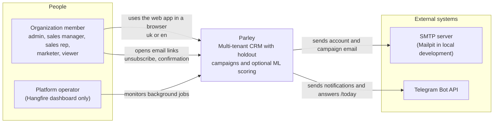

# System context (C4 level 1)

Reading guide: Parley is one system with two human audiences. Organization members work in the web app; the five roles differ in what they can see and change, not in which surface they use. The platform operator is not an organization role: the Hangfire dashboard is the only operator-only surface and it is not exposed to organization admins. Everything that leaves the system does so over SMTP (account and campaign email) or the Telegram Bot API (optional notification channel); the ML scoring service is inside the system boundary because it is deployed from this repository and never exposed to the Internet. The browser also comes back into the system through signed unsubscribe links and email confirmation links, which is why that arrow points at Parley rather than at the mail server.

Verified against: `backend/src/Parley.Api/Controllers/**` (the HTTP surface), `backend/src/Parley.Api/Hangfire/PlatformOperatorDashboardAuthorizationFilter.cs` (operator-only dashboard), `backend/src/Modules/Notifications/Telegram/**` (Telegram client) and `docker-compose.yml` (SMTP and scoring service wiring).
