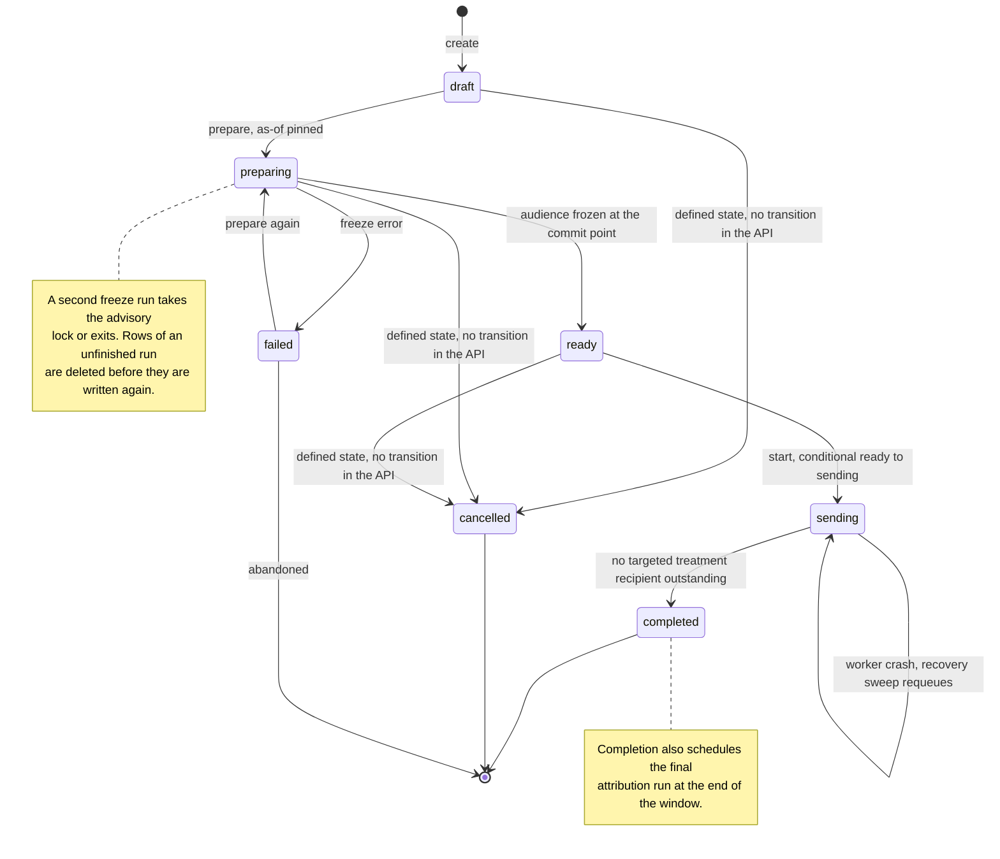
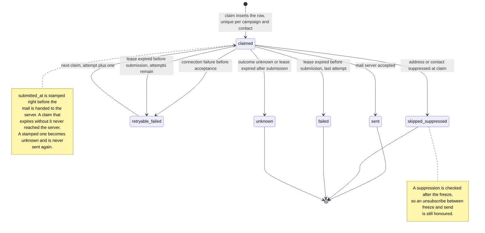

# Campaign and send record states

Reading guide: the campaign states describe the authoring and delivery lifecycle, and the guards are the status column itself: `prepare` accepts `draft`, `preparing` and `failed`; `start` only accepts `ready` and performs a conditional `ready -> sending` update; completion only fires from `sending`. `preparing` is resumable: the freeze deletes the rows of an unfinished run and rewrites them, with `audience_frozen_at` and `ready` set in the same statement. `failed` is a retryable freeze failure, and a campaign that is never prepared again stays failed. The `cancelled` value exists in the stored vocabulary and in the UI styling, but no handler in the current API sets it, so it is drawn as a defined terminal state without a transition rather than pretending an endpoint exists. Send records are a separate machine per recipient: the claim is inserted before the mail leaves, the lease is renewed and `submitted_at` stamped immediately before submission, and only `retryable_failed` can be claimed again. The distinction between a claim that expired before submission (safe to retry) and one that expired after submission (unknown, never resent) is what makes a crash mid-batch safe. `sent`, `skipped_suppressed`, `failed` and `unknown` are terminal. Two arrows leave `claimed` for `failed` because two different rules can produce it: the claim-time failures (no address, render failure) and the last-attempt lease expiry.

Verified against: `backend/src/Modules/Campaigns/Campaigns/Domain/Campaigns/CampaignStatuses.cs`, `Features/Campaigns/Prepare/PrepareCampaignCommandHandler.cs`, `Features/Campaigns/Prepare/CampaignAudienceFreezer.cs`, `Features/Campaigns/Start/StartCampaignCommandHandler.cs`, `Features/Campaigns/Dispatch/Outcomes/CampaignSendCompletion.cs`, `Domain/Sends/SendStatuses.cs`, `Domain/Sends/SendPolicy.cs` and `Features/Campaigns/Dispatch/Claims/CampaignSendClaimer.cs`.
