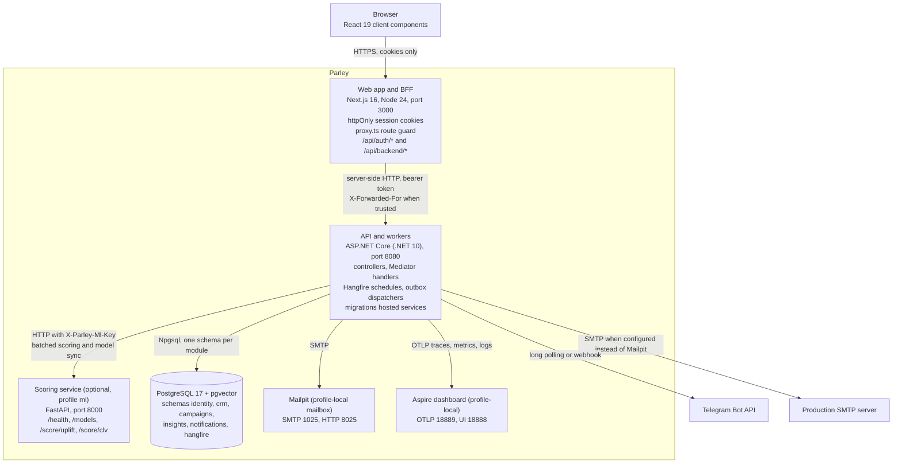

# Containers (C4 level 2)

Reading guide: the browser never talks to the .NET API directly. Next.js is a backend-for-frontend: it keeps the access and refresh tokens in httpOnly cookies, guards the application routes in `proxy.ts`, and forwards only allow-listed endpoints through `/api/backend/*` and the explicit `/api/auth/*` handlers. The API is a modular monolith in one container; the Hangfire worker, the outbox dispatchers and the migrations hosted services run inside the same process, which is why the diagram shows one API container rather than separate workers. PostgreSQL holds one schema per module plus Hangfire's own schema; no module reads another module's tables. The scoring service is an optional container: without it the API keeps working and the priority list stays in RFM mode. Mailpit and the Aspire dashboard are local-development conveniences; production replaces Mailpit with a real SMTP server and the dashboard stays operator-only. There is no Redis or Valkey service: HybridCache stays in process memory and the API has no Redis client or connection setting.

Verified against: `docker-compose.yml` (services, profiles, ports, the `ml-internal`/`ml-edge` networks), `frontend/src/proxy.ts` and `frontend/src/app/api/**` (BFF surface), `backend/src/Parley.Api/Program.cs` and `Startup/**` (workers in process), `backend/src/Modules/*/Module.cs` (one DbContext and schema per module).

