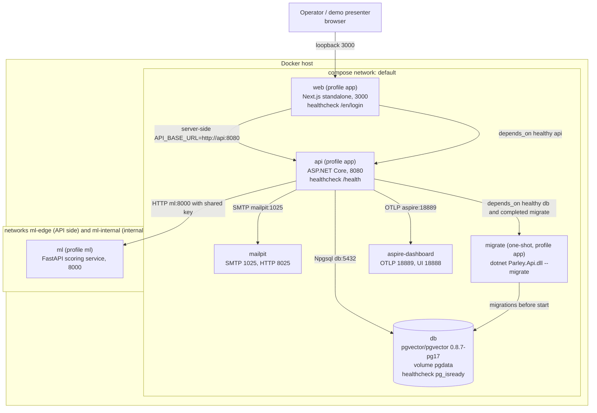

# Deployment view (Docker Compose)

Reading guide: the base `docker-compose.yml` is the production-like layout: the API runs in `Production`, the seed is off, required secrets come from the environment with no fallback, and nothing but Mailpit and the `app` profile publishes a port. The `app` profile adds the one-shot `migrate` service, the API and the web app; the API waits for a healthy database and a completed migration, and the web app waits for a healthy API. The `ml` profile is independent: the API can start and run in RFM mode without it, and it reaches the scoring service over the `ml-edge` network while the service itself listens on `ml-internal`, which is internal to the compose project. Mailpit is the local SMTP target and the demo mailbox; a real deployment replaces it with an SMTP server and keeps the same API settings. The local override (git-ignored, described by `docker-compose.override.example.yml`) publishes PostgreSQL on 5433, the Aspire dashboard on 18888, Valkey on 6379 and the scoring service on 8090, all on loopback only; the demo script uses shifted ports and a separate compose project to run a second isolated stack beside the first.

Verified against: `docker-compose.yml`, `docker-compose.override.example.yml`, `backend/Dockerfile`, `frontend/Dockerfile`, `ml/Dockerfile.serve`, `scripts/demo-up.ps1` and the health checks of the API and the web container.

