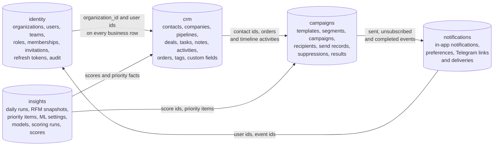
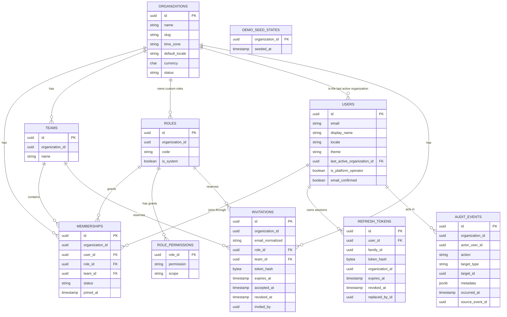
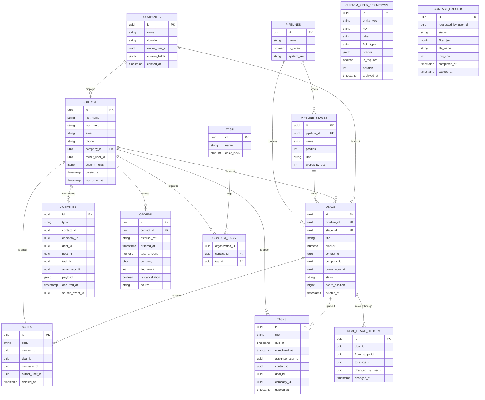
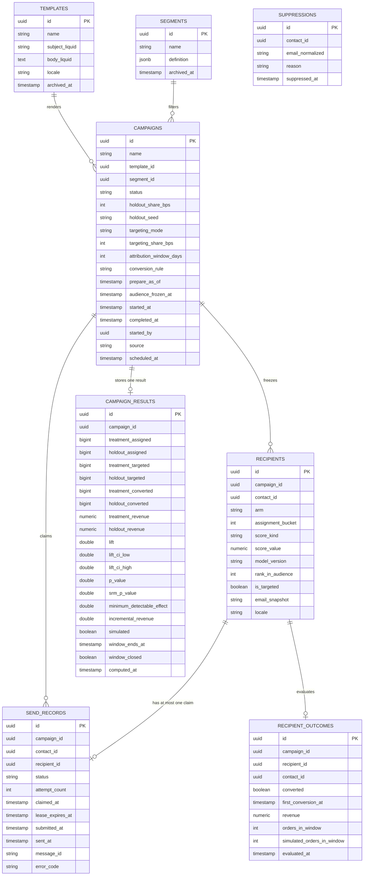
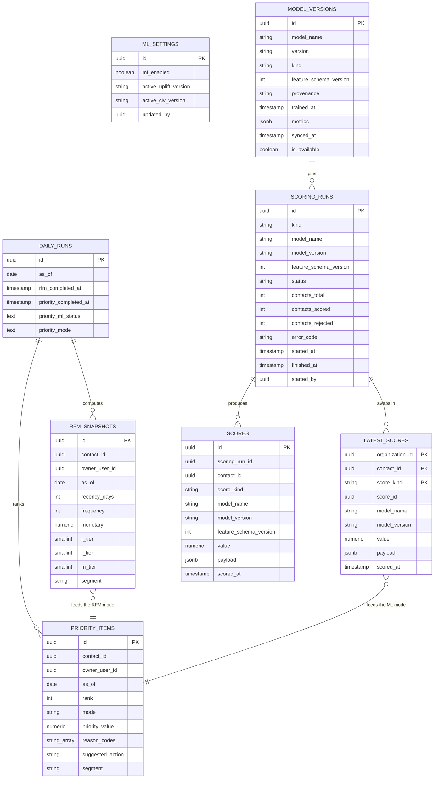
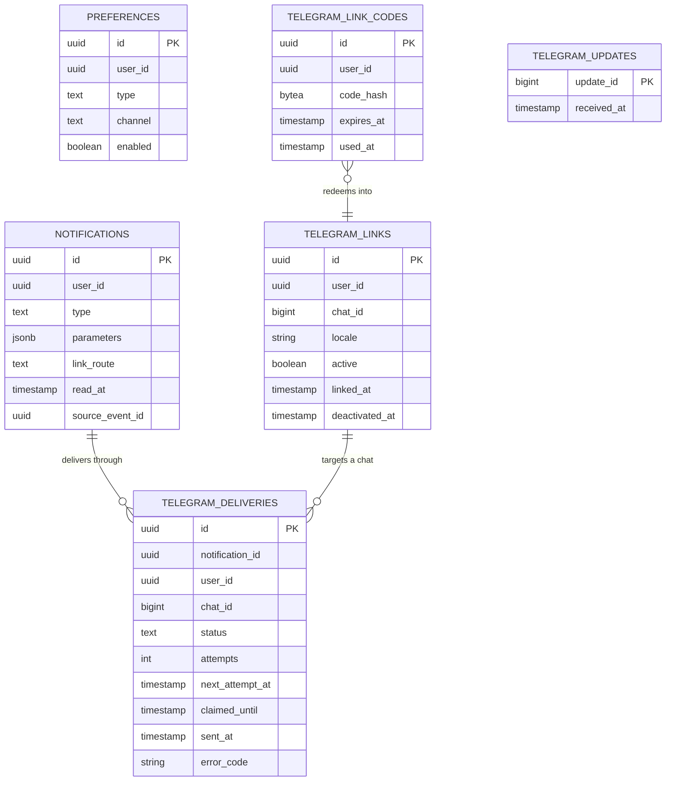

# Entity relationship diagrams

Source: the live schema of the verification stack (`information_schema` on the database built by the EF Core migrations, 2026-11-13), not a hand-written model. Each module owns one PostgreSQL schema and its own `DbContext`; cross-schema references are logical identifiers and have no foreign-key constraint. Only the constraints that exist in the database are drawn as relationships; the reading guide says which links are logical.

## Overview

Reading guide: five schemas, one per module, with no shared tables. Every tenant-scoped business table carries `organization_id` and is filtered by the tenant query filter; that column is not repeated in the per-schema diagrams. Global tables (`users`, `roles` for system roles, `model_versions`, `telegram_updates`, and `demo_seed_states`, which is keyed by organization) are the exceptions. The overview shows only the links that matter across module boundaries: Identity supplies organization and user identifiers to every module; Crm supplies contacts, orders and timeline activities to Campaigns; Insights reads CRM facts and publishes scores that Campaigns uses when a campaign targets by score; Notifications resolves user ids and consumes events. These arrows are logical, not foreign keys. The per-schema diagrams below distinguish real constraints from logical links.

## identity

Reading guide: `organizations` has no `organization_id` of its own, because it is the tenant. A user is global and joins organizations through `memberships`; one member has exactly one role per organization, and a role is either one of the five system roles (`organization_id` null) or the reserved shape of a custom role. `role_permissions` is a join table whose scope text (`own`, `team`, `org`, or null for an organization-level capability) is part of the grant, not of the permission string. Refresh tokens form families: `family_id` ties a rotated chain, `replaced_by_id` marks rotation, and a terminal revocation has no successor; only a SHA-256 hash of the token value is stored. `audit_events` is written from the audit outbox and carries `source_event_id` for deduplication. The three ASP.NET Identity support tables (`user_claims`, `user_logins`, `user_tokens`) and the per-schema `outbox_messages`, `inbox_messages` and `idempotency_keys` are plumbing and are omitted here. The only physical foreign keys are the ones drawn; `audit_events.actor_user_id`, `invitations.invited_by` and `roles.organization_id` are logical identifiers.

## crm

Reading guide: the CRM schema is the largest and the only one where most relationships are logical rather than physical. The physical foreign keys are `contacts.company_id`, `deals.pipeline_id`, `deals.stage_id`, `pipeline_stages.pipeline_id`, `orders.contact_id`, and both columns of `contact_tags`. The arrows from contacts and companies to deals, tasks, notes and activities, and from deals to stage history, are application-level identifiers: the records cross module-internal aggregates and are validated in handlers, not by the database. `activities` is the timeline row for contact, company, deal, task and note events; `source_event_id` deduplicates events that arrive twice. `orders` is the imported purchase fact used by RFM, CLV and scoring, and `external_ref` makes the import idempotent per organization. Soft delete is `deleted_at` on contacts, companies, deals, tasks and notes; lists and search exclude those rows. `custom_fields` is JSONB on contacts, companies and deals, validated against `custom_field_definitions`.

## campaigns

Reading guide: `recipients` is the frozen audience and is written once; `arm` (`treatment`/`holdout`), `assignment_bucket` (0-9999), `score_*`, `rank_in_audience`, `is_targeted` and `email_snapshot` are the values at the freeze instant. `send_records` is the idempotency guard: one claim per campaign and contact, a lease with `submitted_at` stamped right before submission, and a status from the send state machine. The unique claim is what makes a retry or a restart safe. `suppressions` matches either the normalized address or the contact id and is checked at claim time, after the freeze, so an unsubscribe between the freeze and the send is still honoured; it is not drawn as a relationship because the claim matches it by value, not by a stored identifier. `campaign_results` holds one row per campaign with both the assignment counts (for the sample ratio check) and the targeted counts (for the lift comparison); `simulated` distinguishes the demo's injected effect from the A/A fixture. `recipient_outcomes` records what happened in the attribution window and is rebuilt by the attribution run. This schema has no physical foreign keys: each aggregate is written by one transaction, and cross-aggregate reads are scoped by campaign id, so every relationship drawn is a logical identifier.

## insights

Reading guide: one `daily_runs` row per organization and CRM day is the completion marker for the RFM snapshot and the priority build, and it also stores the mode the list was built in. `rfm_snapshots` is one row per contact per day; `priority_items` is the ranked list with the reason codes, segment and suggested action that the UI shows. In RFM mode the priority value comes from the RFM weights; in ML mode it is the additive uplift-based value, and the `mode` column records which rule produced the row. Scoring is isolated in `scoring_runs`, `scores` and `latest_scores`: a run writes its own rows, and only a successful run swaps them into `latest_scores` in one transaction, so a failed run never changes what the product reads. `model_versions` is the synced registry with provenance and metrics; a run pins the version it used, and the freeze pins the same version onto the campaign. All links here are logical; there are no physical foreign keys.

## notifications

Reading guide: an in-app notification is written by a consumer inside its inbox transaction, so a replayed event produces no duplicate; `source_event_id` is the deduplication key. `preferences` is one row per user, notification type and channel, and it is checked before an in-app row or a Telegram delivery is planned. Telegram is a separate delivery pipeline: a link code is hashed and single-use, a link binds one chat, and `telegram_deliveries` is a leased outbox with attempts, backoff (`next_attempt_at`) and a stable error code. `telegram_updates` stores the Telegram `update_id` so a replayed webhook or polled update is a no-op. All identifiers are logical; there are no physical foreign keys in this schema.

## Plumbing tables

Every module schema also contains `outbox_messages`, `inbox_messages` and (except Notifications and Identity) `idempotency_keys`. They are infrastructure, not business entities: the outbox is the transactional event queue, the inbox is the per-consumer deduplication record, and idempotency keys guard retried mutating requests. Their columns and lifecycle are drawn in the outbox sequence diagram, not here.
