# ML pipeline: data to artifact to registry to serving

```mermaid
flowchart LR
    subgraph sources["Public data (never committed)"]
        retail["Online Retail II<br/>UCI 502, CC BY 4.0"]
        criteo["Criteo uplift v2.1<br/>CC BY-NC-SA 4.0, research only"]
    end

    subgraph prepare["Preparation"]
        retailClean["online_retail ingest<br/>clean transactions and customers<br/>schema v1, checksums"]
        criteoClean["criteo ingest and split<br/>float32 parquet, 70/10/20<br/>row-index files"]
        demoExport["demo_export<br/>contacts.csv.gz, orders.csv.gz<br/>manifest with attribution"]
    end

    subgraph train["Training (fixed seeds and configs)"]
        upliftGrid["uplift.train_grid<br/>response, S-learner, T-learner<br/>XGBoost, validation grid"]
        crmDemo["uplift.train_crm_demo<br/>T-learner on the semi-synthetic<br/>crm_uplift fixture"]
        clvFit["clv.fit<br/>BG/NBD and Gamma-Gamma MAP<br/>PyMC-Marketing"]
    end

    subgraph evaluate["Evaluation"]
        upliftEval["uplift.evaluate<br/>winners frozen on validation,<br/>test split opened once,<br/>Qini, AUUC, profit, sample size"]
        crmEval["crm_uplift report<br/>top-20 % gain, AUC, seed table"]
        clvEval["clv.evaluate<br/>ranking and calibration,<br/>customer bootstrap B = 500"]
    end

    subgraph artifacts["Artifacts (git-ignored)"]
        upliftModel["crm_uplift-&lt;date&gt;-&lt;hash&gt;/<br/>manifest.json, treated.ubj, control.ubj"]
        clvModel["clv_bgnbd_gg-&lt;date&gt;-&lt;hash&gt;/<br/>manifest.json, parameters.json"]
        stub["stub artifacts<br/>provenance stub<br/>pipeline check only"]
        results["ml/results<br/>CSV, Markdown, curves<br/>(committed)"]
    end

    subgraph serving["Scoring service (FastAPI, profile ml)"]
        registry["artifact registry at startup<br/>manifest schema 2, checksums,<br/>feature order, served provenance"]
        endpoints["/health, /models,<br/>/score/uplift, /score/clv<br/>X-Parley-Ml-Key, batch at most 1000"]
    end

    subgraph product["Product (.NET)"]
        sync["ScoringModelsSync<br/>GET /models into insights.model_versions"]
        settings["ML settings<br/>activation and switch"]
        runs["Scoring run job<br/>pinned version, latest_scores"]
        priority["Priority list and campaign targeting"]
    end

    retail --> retailClean
    criteo --> criteoClean
    retailClean --> demoExport
    retailClean --> clvFit
    criteoClean --> upliftGrid
    demoExport --> crmDemo
    upliftGrid --> upliftEval
    crmDemo --> crmEval
    clvFit --> clvEval
    upliftEval --> results
    crmEval --> results
    clvEval --> results
    crmDemo --> upliftModel
    clvEval --> clvModel
    stub --> registry
    upliftModel --> registry
    clvModel --> registry
    registry --> endpoints
    endpoints --> sync
    sync --> settings
    settings --> runs
    runs --> priority
```

Reading guide: the pipeline starts from two public datasets that are never committed. Online Retail II is cleaned once into a frozen schema with checksums; its cleaned transactions feed the CLV fit, and the demo export built from the same frozen Parquet is the input of the semi-synthetic `crm_uplift` fixture (the CRM's own seed no longer reads it). Criteo is research-only: it is ingested and split 70/10/20, and the grid trains a response-propensity baseline and the S- and T-learners on it. Every training run is fixed by a config, a seed set and a test-access record; the winners and the profit thresholds are chosen on the validation split before the test split is read, which is why `uplift.evaluate` has a separate recorded test phase. The evaluation writes the committed tables and figures in `ml/results/` and the research conclusions. The Criteo grid writes research output only; the served uplift artifact is the semi-synthetic `crm_uplift` model, and the served CLV artifact is written by the CLV evaluation, which runs after the fit. Each served artifact is one directory under `artifacts/models/` with a schema-2 manifest that lists the files and their SHA-256 checksums. The FastAPI service loads that directory at startup, verifies every checksum, feature order and provenance, and refuses a manifest it cannot serve; only `public_dataset`, `semi_synthetic` and `stub` artifacts are served, so no Criteo artifact can reach a contact. The .NET side never reads the artifact directory: it calls `/models`, stores the versions in `insights.model_versions`, and an admin activates one in ML settings; a scoring run then pins that exact version and swaps `latest_scores` only after a successful run. The stub artifact exists for a clone without `uv` or without a trained model: it passes the pipeline and is never preferred over a trained model.

Verified against: `ml/configs/*.yaml` (`criteo_ingest`, `criteo_split`, `uplift_grid`, `uplift_final`, `crm_uplift_demo`, `clv_fit`, `clv_eval`, `online_retail`, `serving`), `ml/parley_ml/datasets/**`, `ml/parley_ml/uplift/**`, `ml/parley_ml/clv/**`, `ml/parley_ml/serving/artifacts.py` and `service.py`, `ml/parley_ml/serving/stub.py`, `ml/scripts/write_stub_artifacts.py`, `ml/Dockerfile.train` and `Dockerfile.serve`, `backend/src/Modules/Insights/Insights/Features/Scoring/Models/ScoringModelsSync.cs`, `Features/Scoring/Run/ScoringRunRunner.cs`, and the ML results in `ml/results/`.
