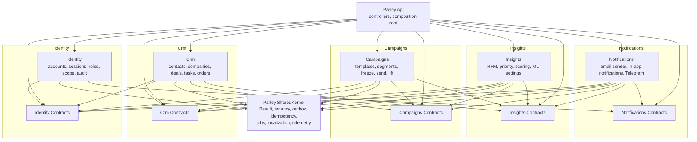

# Module dependencies (C4 level 3)

Reading guide: the diagram is drawn from the project references, not from intent. A module implementation may reference its own `Contracts` project and other modules' `Contracts` projects only; it never references another module's implementation, and it never reads another module's schema. `Parley.Api` is the only project that references every implementation, because it is the composition root and host. `Parley.SharedKernel` is referenced by every project, including the contract projects (for `Result`, errors, tenancy abstractions and the outbox base types). The `Contracts` nodes are the published surface: interfaces, DTOs and integration events. The arrows that carry events at runtime are not code references, so they are listed here rather than drawn:

| Producer | Event | Consumer |
|---|---|---|
| Identity | `OrganizationCreated` | Crm (default pipeline), Insights (daily-run row) |
| Identity | `MemberActivated`, `MemberDeactivated` | Notifications (in-app notification) |
| SharedKernel audit outbox | `AuditRecorded` | Identity (audit viewer row) |
| Crm | `TaskAssigned`, `TaskDueSoon`, `DealAssigned` | Notifications |
| Campaigns | `CampaignEmailSent`, `RecipientUnsubscribed` | Crm (timeline activity, suppression) |
| Campaigns | `CampaignCompleted` | Notifications |
| Insights | `ScoringRunCompleted` | Notifications, Insights (priority rebuild) |
| Insights | `MlSettingsChanged` | Insights (priority rebuild on ML on/off) |

Events without a registered consumer in this codebase (`CampaignStarted`, `ContactCreated`, `ContactDeleted`, `ContactRestored`, `DealClosed`, `DealStageChanged`, `OrderRecorded`, `TelegramLinked`, `TelegramUnlinked`) are written to the outbox but currently have no subscriber; they are not shown as edges to avoid claiming a delivery that does not exist. The architecture tests keep the reference graph closed, so a forbidden module-to-module implementation reference fails the build.

Verified against: every `backend/src/Modules/*/*/*.csproj` and `backend/src/Modules/*/*.Contracts/*.csproj`, the `AddIntegrationEventConsumer` registrations in each `Module.cs`, and the event types under `backend/src/Modules/*/*.Contracts/Events/`.
