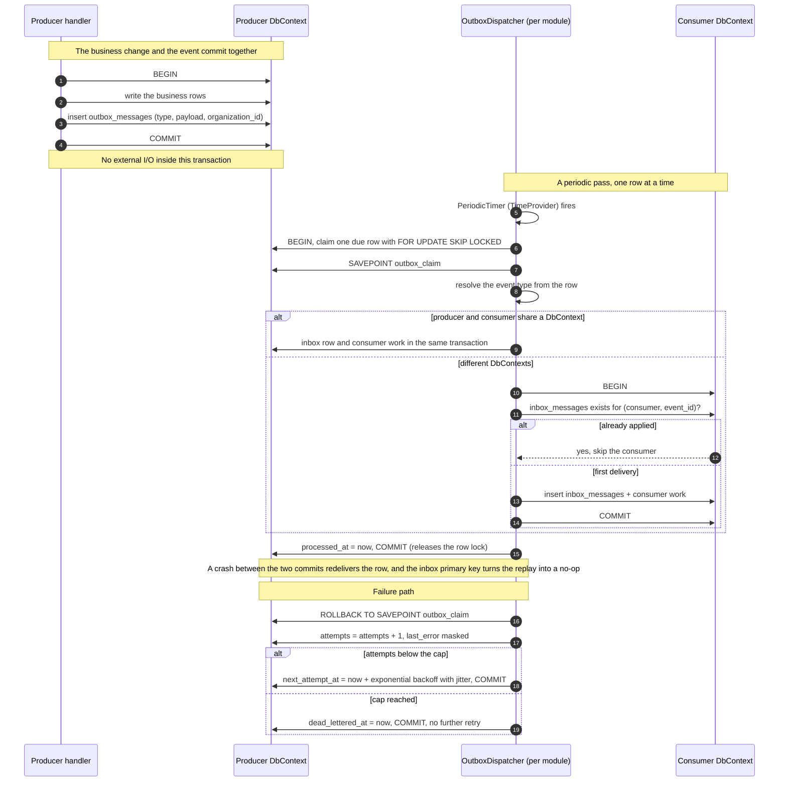

# Outbox to inbox with an idempotent consumer

Reading guide: the outbox row is written in the same transaction as the business change, so either both exist or neither does. One dispatcher runs per module database as a `BackgroundService`; it claims due rows with `FOR UPDATE SKIP LOCKED`, so two instances never deliver the same row, and it holds the row lock until the outcome is recorded. A consumer that owns another database runs in its own transaction: it checks the inbox primary key `(consumer, event_id)`, inserts the inbox row and does its work, and commits before the producer row is marked processed. A crash between those two commits redelivers the event, and the inbox key makes the second delivery a no-op; delivery is at-least-once, and because consumers only do database work the result is effectively once. Failure is recorded in the claim transaction itself after rolling back to the savepoint, with exponential backoff and jitter, and after the attempt cap the row becomes a dead letter with a masked last error. The same transaction is used when producer and consumer share a DbContext, which is why the diagram has both branches. Consumers never call an external service, so a retry cannot duplicate a side effect outside the database.

Verified against: `backend/src/Parley.SharedKernel/Outbox/Dispatching/OutboxDispatcher.cs`, `Outbox/Publishing/DbContextOutbox.cs`, `Outbox/Messages/**`, `Outbox/Consumers/**`, and the `AddOutbox` and `AddIntegrationEventConsumer` registrations in every module `Module.cs`.

