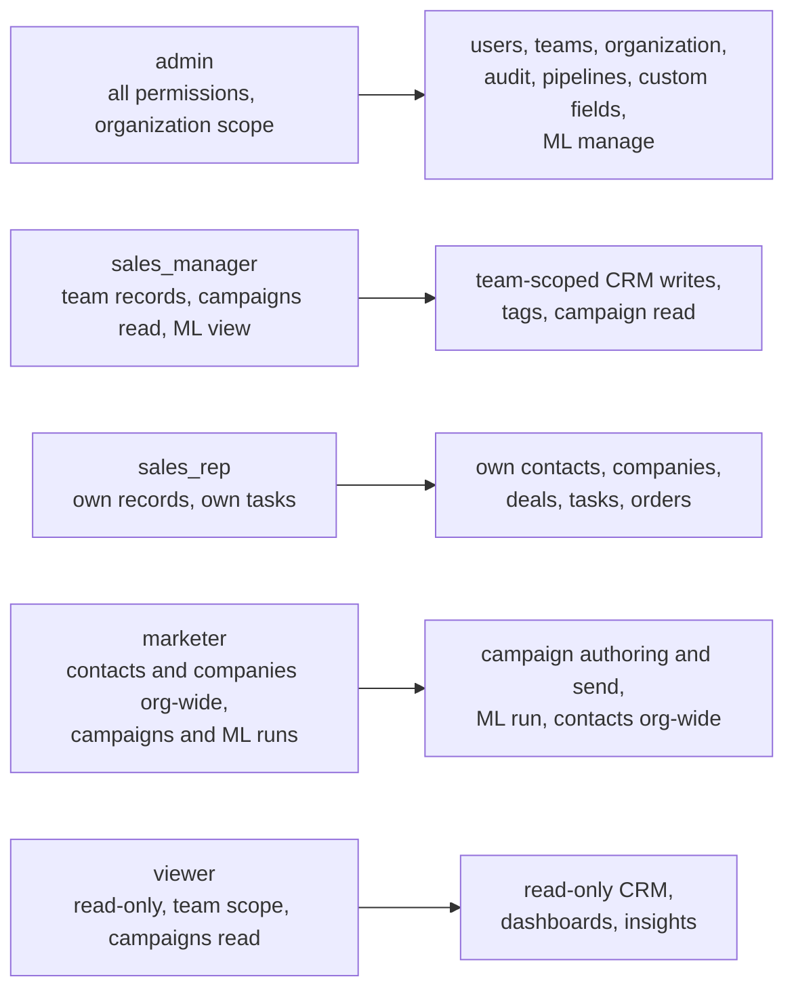

# Roles and permission grants

The five system roles are fixed. A member has one role per organization. The value in a cell is the record scope of the grant; `org` means every record of the organization, `team` the records of the member's team, `own` the records the member owns (tasks use the assignee), `yes` an organization-level capability with no record scope, and `-` not granted. The scope is an attribute of the role-permission grant, never part of the permission string.

| Permission | admin | sales_manager | sales_rep | marketer | viewer |
|---|---|---|---|---|---|
| `contacts.read` | org | team | own | org | team |
| `contacts.write` | org | team | own | org | - |
| `contacts.delete` | org | team | - | - | - |
| `contacts.export` | org | team | - | org | - |
| `companies.read` | org | team | own | org | team |
| `companies.write` | org | team | own | org | - |
| `companies.delete` | org | team | - | - | - |
| `deals.read` | org | team | own | org | team |
| `deals.write` | org | team | own | - | - |
| `deals.delete` | org | team | - | - | - |
| `tasks.read` | org | team | own | own | team |
| `tasks.write` | org | team | own | own | - |
| `tasks.delete` | org | team | own | own | - |
| `activities.read` | org | team | own | org | team |
| `activities.write` | org | team | own | org | - |
| `orders.read` | org | team | own | org | team |
| `pipelines.manage` | yes | - | - | - | - |
| `customfields.manage` | yes | - | - | - | - |
| `tags.manage` | yes | yes | - | yes | - |
| `campaigns.read` | yes | yes | - | yes | yes |
| `campaigns.manage` | yes | - | - | yes | - |
| `campaigns.send` | yes | - | - | yes | - |
| `dashboards.view` | yes | yes | yes | yes | yes |
| `insights.view` | yes | yes | yes | yes | yes |
| `insights.ml.view` | yes | yes | - | yes | - |
| `insights.ml.run` | yes | - | - | yes | - |
| `insights.ml.manage` | yes | - | - | - | - |
| `users.manage` | yes | - | - | - | - |
| `teams.manage` | yes | - | - | - | - |
| `org.manage` | yes | - | - | - | - |
| `audit.read` | yes | - | - | - | - |

Reading guide: the table is generated from the same matrix that seeds the system roles, so the seeded rows and this page cannot drift apart. Admin is the only role that manages users, teams, the organization, pipelines, custom fields and ML models; it is also the only role with `audit.read`. Sales managers work at team scope and can read campaigns but not author or send them. Sales reps work at own scope and have no campaign access at all; their task and deal scope follows assignment and ownership. The marketer is the campaign role: organization-wide contact, company and activity access, campaign authoring and sending, and ML runs, but no user, team, pipeline or ML-model administration. Viewer is read-only with team scope, including campaign lists and insight screens, and cannot send or change records. Two consequences are visible in the demo: a rep never sees another rep's contacts, and a viewer is refused the campaign builder. A missing permission returns 403; a record outside the caller's scope returns 404 so its existence is not disclosed.

Verified against: `backend/src/Modules/Identity/Identity/Authorization/Seed/SystemRoleSeed.cs` (the matrix and the `HasData` source of the migration), `backend/src/Modules/Identity/Identity.Contracts/Authorization/Permissions.cs` (the catalogue), `RoleScopeNames.cs` and `SystemRoles.cs`.
