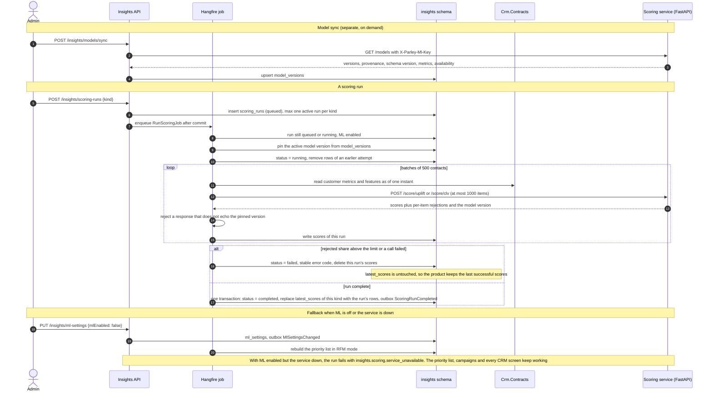

# Scoring run, failure path and fallback

Reading guide: a scoring run is queued from the API and executed by a background job; no user request waits on the scoring service. The job pins one model version from the synced registry and refuses a response that reports another version, so a run cannot mix models. It reads CRM facts in batches of 500 as of one instant, sends at most 1000 items per call, and writes each batch of scores under the run id. The commit point is a single transaction that completes the run, replaces `latest_scores` for that kind with the run's rows, and writes `ScoringRunCompleted` to the outbox; if anything fails before that point, the run ends failed with a stable code and its own rows are deleted, while `latest_scores`, and therefore every screen, stays on the last successful scores. Rejections are counted and a run whose rejected share exceeds 5 % is failed rather than published. Turning ML off is a separate switch: the settings change is committed with an outbox event, the priority list is rebuilt in RFM mode, and no scoring call is made. With ML on but the scoring service unreachable, the run fails with `insights.scoring.service_unavailable` and the product behaves exactly like the last successful run, which is the state captured in the ML-down evidence. The model registry page shows each version's provenance; the demo `crm_uplift` model is labelled semi-synthetic.

Verified against: `backend/src/Modules/Insights/Insights/Features/Scoring/Run/ScoringRunRunner.cs`, `Features/Scoring/Client/ScoringServiceClient.cs`, `Features/Scoring/Models/ScoringModelsSync.cs`, `Options/InsightsScoringOptions.cs`, `ml/parley_ml/serving/service.py`, `ml/parley_ml/serving/scoring.py`, and `backend/src/Modules/Insights/Insights/Features/Priority/Build/PriorityBuildRunner.cs`.

