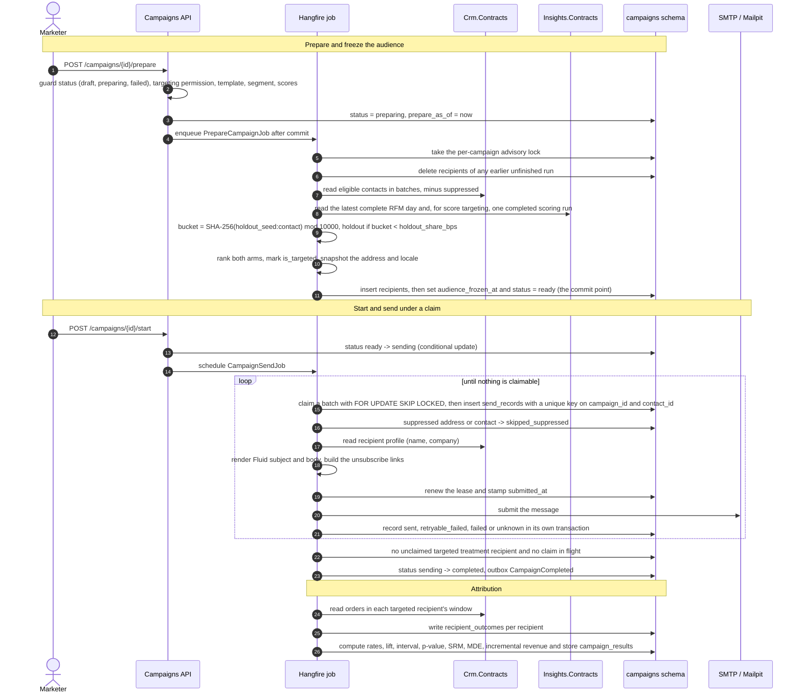

# Campaign freeze, holdout, send claim and attribution

Reading guide: the freeze is the only step that writes the audience, and it is idempotent: a resumed run deletes its own unfinished rows and writes them again, and the `audience_frozen_at` update together with `status = ready` is the single commit point that makes the audience visible to sending and review. The holdout arm is a deterministic function of the campaign seed (the campaign id) and the contact id, so the same campaign always assigns the same people; the same vectors are asserted in C# and Python. Targeting ranks contacts across both arms and only targeted treatment recipients are sent to, which keeps the comparison between the two arms on the same selected population. The send loop claims a row in `send_records` before any mail leaves, under a lease, and stamps `submitted_at` immediately before submission. A claim whose lease expires without that stamp was never submitted and returns to the pool; a claim stamped as submitted but not recorded becomes `unknown` and is never sent again, so a crash cannot produce a second message. Each outcome is a short transaction and the accepted case writes `CampaignEmailSent` to the outbox in the same commit, which is how the CRM timeline and the suppression state learn about the send. Completion is conditional on `sending`, so two workers finishing together complete the campaign once. Attribution then reads orders from the CRM outcome reader and stores one result row per campaign; the sample ratio check uses assigned counts, the lift comparison uses targeted counts, and a result that includes a simulated order is labelled simulated everywhere.

Verified against: `backend/src/Modules/Campaigns/Campaigns/Features/Campaigns/Prepare/**`, `Domain/Holdout/HoldoutAssigner.cs`, `Features/Campaigns/Start/**`, `Features/Campaigns/Dispatch/**`, `Features/Campaigns/Attribution/**`, and the seeded historic campaigns in `Features/Campaigns/DemoSeed/**`.

