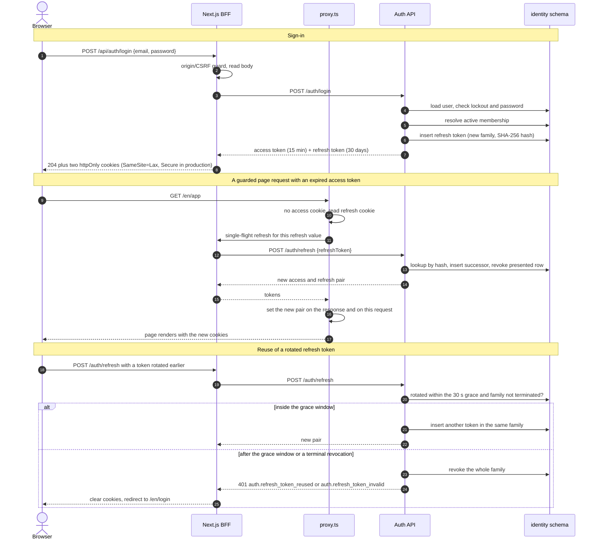

# Sign-in and session refresh through the BFF

Reading guide: the browser never holds a token. The login route handler forwards the credentials to the API and writes both tokens as httpOnly cookies; the API stores only a SHA-256 hash of the refresh value. On any guarded navigation `proxy.ts` checks the access cookie first and only refreshes when it is missing, using a single-flight wrapper so concurrent tabs or prefetches share one rotation call. The API rotates in one transaction: it inserts the successor and conditionally revokes the presented row, so two racing requests cannot both win; the loser takes the grace path. A token rotated less than 30 seconds ago returns a new pair in the same family (two tabs refreshing at once is normal), but any terminal revocation in the family (logout, password reset, family revocation) blocks that path. A rotated token presented after the grace window, or an already revoked token, revokes the entire family and answers 401 with a stable code; the BFF then clears the cookies and redirects to the localized login page. A network failure, but not a rejection, passes the request through so the page can render its own error state instead of destroying the session. Sign-out calls the API to revoke the family and clears both cookies.

Verified against: `frontend/src/proxy.ts`, `frontend/src/lib/session/refresh.ts`, `frontend/src/lib/session/tokens.ts`, `frontend/src/lib/bff/handlers.ts`, `frontend/src/app/api/auth/*/route.ts`, `backend/src/Modules/Identity/Identity/Authentication/Refresh/RefreshTokenService.cs`, `backend/src/Modules/Identity/Identity/Features/Sessions/**`, and the `Auth` section of `backend/src/Parley.Api/appsettings.json`.
