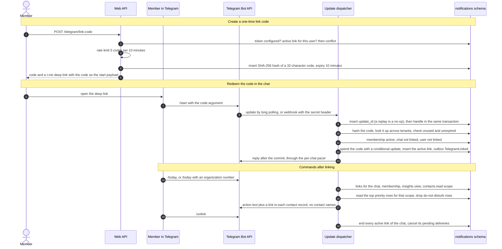
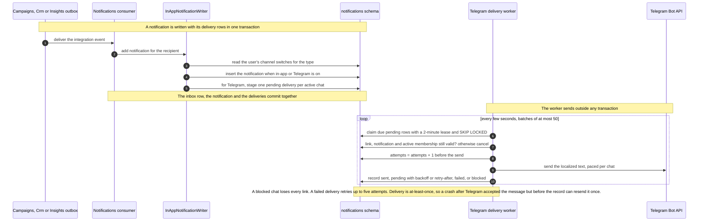

# Telegram link and notification flow

Reading guide: the channel is off until a bot token is configured; without one the API answers `telegram.not_configured` and the rest of the product runs normally. Linking is a one-time code: the API stores only its SHA-256 hash, the code expires after ten minutes and is limited to five per ten minutes per user, and a user who already has an active link or a chat that is already linked is refused. The same update entry serves polling and webhook mode; the webhook checks the secret header in constant time before reading the body, and polling moves its offset only after an update is handled. The update id is inserted in the same transaction as the command, so a replayed Telegram update is a no-op. `/today` is gated by `insights.view` and follows the `contacts.read` scope of the member, exactly like the web list; it lists next actions and links, never contact names, and never suggests a contact with a do-not-disturb caution. `/unlink` and a chat that blocked the bot both end every link of the chat and cancel its pending deliveries. Notifications are fanned out at write time: a consumer writes the in-app row and, when the Telegram switch for that type is on, one pending delivery per active chat, all inside the inbox transaction. The delivery worker claims due rows with a lease and `SKIP LOCKED`, re-checks the link and the membership, counts the attempt before sending, and records the outcome; a retryable failure is rescheduled with exponential backoff or Telegram's `retry_after`, while a blocked chat ends the link. Delivery is deliberately at-least-once: a crash after Telegram accepted a message but before the outcome was saved can resend it, because the unique row prevents duplicate deliveries, not duplicate sends.

Verified against: `backend/src/Modules/Notifications/Notifications/Telegram/**` (`LinkRules`, `LinkRedeemer`, `LinkEnder`, `ChatUnlinker`, `TodayComposer`, `DeliveryPlanner`, `DeliveryClaimer`, `DeliveryAttempt`, `DeliveryRules`, `DeliveryWorker`, `PollingWorker`, `UpdateDispatcher`, `WebhookSecret`), `Features/Telegram/LinkCode/**`, `Features/Telegram/Updates/**`, `Inbox/InAppNotificationWriter.cs`, `Notifications/Module.cs` (options and registrations), `backend/src/Parley.Api/Controllers/Telegram/**`, and the `Telegram` section of `backend/src/Parley.Api/appsettings.json`.

