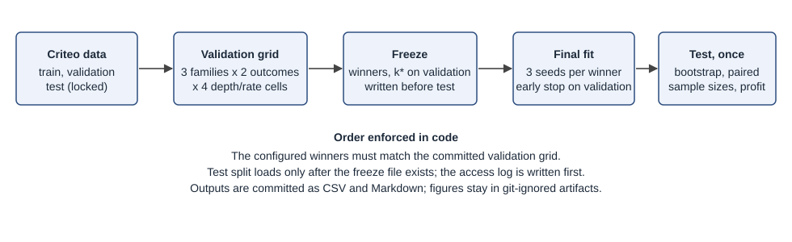

# RQ1: does ranking by predicted uplift beat ranking by response propensity?

The test split was opened by two test-phase attempts (the first stopped for low memory and wrote no results; see Protocol in the notes below) and by one reproduction run. The reproduction run compares every committed output byte for byte; its record is git-ignored (artifacts/final/reproduction.json). Winners and k* were fixed on the validation split before the test split was read. Intervals are 95 % Poisson-bootstrap percentile intervals with B = 200; differences are paired (same bootstrap weights for both models).

## Provenance

| Item | Value |
|---|---|
| Final config | `uplift_final.yaml`, sha256 `21e91572bbc7b99bcd25e294d27cd0c0e46564953f081b87ad044e75386f5637` |
| Validation grid | `results/uplift_validation_grid.csv`, sha256 `1825f61d2e1620e5beb80ba6936877c389351734a3b2f915707c0a44b963ffd8` |
| Freeze file | sha256 `9183cbefcad4573c00cb8d3ba2262a3082fa3b29f529a6ea7af4eead5b97eeac` |
| Git commit | `0e535a4dfa537caae2bba87771cc4f52cc1ad8ce` (ml/ has uncommitted changes) |
| Environment | hash `697674151dce`, Python 3.12.10, causalml 0.18.0, numpy 2.4.6, pandas 3.1.1, polars 2.1.0, pyarrow 26.0.1, scikit-learn 1.9.1, xgboost 3.4.1 |
| Seeds | 20261112, 20261113, 20261114 |
| Test rows | 2,795,920 (2,376,531 treated, 419,389 control) |
| Family config (response) | `uplift_response.yaml`, sha256 `e598bd01101646f40c2028e8e29d0dfc9746aedd13c5717201b03793a8d0b239` |
| Family config (s) | `uplift_s.yaml`, sha256 `987edf2c1dcc75a277c610e2e09de4679b40881ac79430cf66f07f06254fc7c3` |
| Family config (t) | `uplift_t.yaml`, sha256 `64d425993baddd9203007e0381ac9157d8d1026eda1ce3fa9e731c42ecfa3205` |
| Saved model checksums | `model_checksums.json` (18 boosters), sha256 `9755c17cff546c86e8e48a3884b5a1eed46a4068c117faae78d3bdf77734ec21` |

## Pipeline



## Winners fixed on validation

| Outcome | Family | max_depth | learning_rate | Validation qini_coefficient |
|---|---|---|---|---|
| visit | Response propensity | 6 | 0.1 | 4152.37 |
| visit | S-learner | 4 | 0.05 | 4308.04 |
| visit | T-learner | 6 | 0.05 | 4260.65 |
| conversion | Response propensity | 6 | 0.1 | 551.31 |
| conversion | S-learner | 4 | 0.1 | 504.67 |
| conversion | T-learner | 6 | 0.1 | 395.63 |

## Test results: visit (primary)

Point values on the full test split, seed 0 with the seed range over the three seeds in brackets.

| Family | Qini coefficient | AUUC | Separate relative AUUC | Uplift@0.05 | Uplift@0.10 | Uplift@0.20 | Uplift@0.30 | Uplift@0.50 |
|---|---|---|---|---|---|---|---|---|
| Response propensity | 8559.78 [8559.78, 8559.78] | 24460.91 [24460.91, 24460.91] | 0.9427 [0.9427, 0.9427] | 0.0547 [0.0547, 0.0547] | 0.0523 [0.0523, 0.0523] | 0.0390 [0.0390, 0.0390] | 0.0295 [0.0295, 0.0295] | 0.0198 [0.0198, 0.0198] |
| S-learner | 9227.64 [9227.64, 9227.64] | 25205.73 [25205.73, 25205.73] | 0.9566 [0.9566, 0.9566] | 0.0947 [0.0947, 0.0947] | 0.0659 [0.0659, 0.0659] | 0.0405 [0.0405, 0.0405] | 0.0299 [0.0299, 0.0299] | 0.0196 [0.0196, 0.0196] |
| T-learner | 8456.56 [8456.56, 8456.56] | 24300.20 [24300.20, 24300.20] | 0.9318 [0.9318, 0.9318] | 0.0859 [0.0859, 0.0859] | 0.0606 [0.0606, 0.0606] | 0.0389 [0.0389, 0.0389] | 0.0291 [0.0291, 0.0291] | 0.0190 [0.0190, 0.0190] |

Paired differences from the response propensity model, 95 % interval, share of bootstrap replicates above zero:

| Model minus response | Statistic | Difference [95 % CI] | Share > 0 |
|---|---|---|---|
| S-learner | qini_coefficient | 667.86 [408.72, 932.55] | 1.000 |
| S-learner | auuc | 744.82 [441.08, 1054.14] | 1.000 |
| S-learner | separate_relative_auuc | 0.0140 [0.0024, 0.0255] | 0.990 |
| S-learner | uplift_at_0.10 | 0.0136 [0.0105, 0.0170] | 1.000 |
| T-learner | qini_coefficient | -103.23 [-638.74, 527.80] | 0.330 |
| T-learner | auuc | -160.71 [-789.50, 580.69] | 0.290 |
| T-learner | separate_relative_auuc | -0.0109 [-0.0345, 0.0164] | 0.180 |
| T-learner | uplift_at_0.10 | 0.0082 [0.0052, 0.0121] | 1.000 |

Point values for each model on the test split (bootstrap intervals in brackets):

| Family | Qini coefficient | AUUC | Separate relative AUUC |
|---|---|---|---|
| Response propensity | 8559.78 [7980.43, 9188.40] | 24460.91 [22877.92, 25930.00] | 0.9427 [0.8843, 0.9948] |
| S-learner | 9227.64 [8584.66, 9865.65] | 25205.73 [23602.06, 26651.14] | 0.9566 [0.9001, 1.0114] |
| T-learner | 8456.56 [7800.88, 9023.65] | 24300.20 [22848.34, 25650.99] | 0.9318 [0.8748, 0.9829] |

### Sample-size curve: visit

Qini coefficient and AUUC on test subsamples (same rows for every model), with intervals.

| Sample | Rows | Family | Qini coefficient | AUUC |
|---|---|---|---|---|
| 50000 | 50,000 | Response propensity | 135.37 [51.33, 208.97] | 402.42 [202.24, 607.64] |
| 50000 | 50,000 | S-learner | 194.44 [110.26, 272.84] | 470.29 [273.04, 658.81] |
| 50000 | 50,000 | T-learner | 144.97 [58.15, 228.20] | 412.47 [231.45, 588.81] |
| 100000 | 100,000 | Response propensity | 324.99 [204.44, 444.92] | 925.29 [587.92, 1240.85] |
| 100000 | 100,000 | S-learner | 348.40 [232.47, 486.73] | 951.75 [634.03, 1259.54] |
| 100000 | 100,000 | T-learner | 298.68 [187.56, 409.24] | 893.89 [603.88, 1168.80] |
| 1000000 | 1,000,000 | Response propensity | 3176.07 [2826.51, 3526.35] | 9109.10 [8209.78, 9956.07] |
| 1000000 | 1,000,000 | S-learner | 3449.72 [3137.10, 3810.28] | 9415.98 [8494.89, 10283.61] |
| 1000000 | 1,000,000 | T-learner | 3022.64 [2636.28, 3417.43] | 8915.81 [7983.34, 9697.96] |
| full | 2,795,920 | Response propensity | 8559.78 [7980.43, 9188.40] | 24460.91 [22877.92, 25930.00] |
| full | 2,795,920 | S-learner | 9227.64 [8584.66, 9865.65] | 25205.73 [23602.06, 26651.14] |
| full | 2,795,920 | T-learner | 8456.56 [7800.88, 9023.65] | 24300.20 [22848.34, 25650.99] |

| Sample | Model minus response | Qini difference [CI] | AUUC difference [CI] |
|---|---|---|---|
| 50000 | S-learner | 59.08 [15.83, 110.19] | 67.87 [16.54, 127.03] |
| 50000 | T-learner | 9.61 [-64.50, 90.33] | 10.05 [-76.36, 104.21] |
| 100000 | S-learner | 23.41 [-46.24, 91.66] | 26.46 [-54.43, 105.20] |
| 100000 | T-learner | -26.31 [-136.26, 83.89] | -31.39 [-158.07, 96.42] |
| 1000000 | S-learner | 273.65 [114.21, 456.86] | 306.87 [120.18, 523.21] |
| 1000000 | T-learner | -153.43 [-434.73, 183.09] | -193.29 [-519.71, 197.30] |
| full | S-learner | 667.86 [408.72, 932.55] | 744.82 [441.08, 1054.14] |
| full | T-learner | -103.23 [-638.74, 527.80] | -160.71 [-789.50, 580.69] |

### Conditional profit at k* (visit)

Profit(k) = N(k) * (uplift(k) - c/v) per unit of value v; k* is the fraction with the highest mean validation profit for each c/v. Values are on the test split with bootstrap intervals.

| Family | c/v | k* | Profit [CI] |
|---|---|---|---|
| Response propensity | 0.001 | 0.78 | 26479.8 [24678.3, 28115.2] |
| Response propensity | 0.005 | 0.42 | 20813.0 [18986.0, 22409.9] |
| Response propensity | 0.01 | 0.28 | 16419.8 [14598.2, 18069.6] |
| Response propensity | 0.02 | 0.16 | 10985.8 [9425.0, 12580.9] |
| S-learner | 0.001 | 0.68 | 26612.4 [24816.1, 28336.4] |
| S-learner | 0.005 | 0.46 | 20675.5 [18911.6, 22305.7] |
| S-learner | 0.01 | 0.27 | 17148.1 [15401.3, 18921.0] |
| S-learner | 0.02 | 0.12 | 12622.8 [11201.7, 13978.2] |
| T-learner | 0.001 | 1.00 | 26114.6 [24412.7, 27661.2] |
| T-learner | 0.005 | 0.38 | 20338.0 [18657.0, 21838.2] |
| T-learner | 0.01 | 0.26 | 16222.4 [14493.6, 17747.1] |
| T-learner | 0.02 | 0.13 | 11440.7 [9927.5, 12812.0] |

## Test results: conversion (secondary)

Point values on the full test split, seed 0 with the seed range over the three seeds in brackets.

| Family | Qini coefficient | AUUC | Separate relative AUUC | Uplift@0.05 | Uplift@0.10 | Uplift@0.20 | Uplift@0.30 | Uplift@0.50 |
|---|---|---|---|---|---|---|---|---|
| Response propensity | 1102.37 [1102.37, 1102.37] | 2895.21 [2895.21, 2895.21] | 0.1091 [0.1091, 0.1091] | 0.0137 [0.0137, 0.0137] | 0.0085 [0.0085, 0.0085] | 0.0048 [0.0048, 0.0048] | 0.0035 [0.0035, 0.0035] | 0.0022 [0.0022, 0.0022] |
| S-learner | 1139.83 [1139.83, 1139.83] | 2938.17 [2938.17, 2938.17] | 0.1112 [0.1112, 0.1112] | 0.0128 [0.0128, 0.0128] | 0.0083 [0.0083, 0.0083] | 0.0050 [0.0050, 0.0050] | 0.0036 [0.0036, 0.0036] | 0.0023 [0.0023, 0.0023] |
| T-learner | 697.95 [697.95, 697.95] | 2419.78 [2419.78, 2419.78] | 0.0917 [0.0917, 0.0917] | 0.0115 [0.0115, 0.0115] | 0.0071 [0.0071, 0.0071] | 0.0042 [0.0042, 0.0042] | 0.0030 [0.0030, 0.0030] | 0.0018 [0.0018, 0.0018] |

Paired differences from the response propensity model, 95 % interval, share of bootstrap replicates above zero:

| Model minus response | Statistic | Difference [95 % CI] | Share > 0 |
|---|---|---|---|
| S-learner | qini_coefficient | 37.45 [-32.56, 109.28] | 0.820 |
| S-learner | auuc | 42.96 [-39.06, 126.94] | 0.815 |
| S-learner | separate_relative_auuc | 0.0020 [-0.0010, 0.0049] | 0.875 |
| S-learner | uplift_at_0.10 | -0.0001 [-0.0006, 0.0003] | 0.280 |
| T-learner | qini_coefficient | -404.43 [-553.91, -271.02] | 0.000 |
| T-learner | auuc | -475.43 [-650.99, -319.48] | 0.000 |
| T-learner | separate_relative_auuc | -0.0174 [-0.0235, -0.0118] | 0.000 |
| T-learner | uplift_at_0.10 | -0.0013 [-0.0020, -0.0007] | 0.000 |

Point values for each model on the test split (bootstrap intervals in brackets):

| Family | Qini coefficient | AUUC | Separate relative AUUC |
|---|---|---|---|
| Response propensity | 1102.37 [958.02, 1263.17] | 2895.21 [2565.50, 3315.17] | 0.1091 [0.0972, 0.1236] |
| S-learner | 1139.83 [987.05, 1324.58] | 2938.17 [2601.43, 3371.92] | 0.1112 [0.0994, 0.1267] |
| T-learner | 697.95 [527.61, 880.21] | 2419.78 [2090.56, 2781.38] | 0.0917 [0.0802, 0.1045] |

### Sample-size curve: conversion

Qini coefficient and AUUC on test subsamples (same rows for every model), with intervals.

| Sample | Rows | Family | Qini coefficient | AUUC |
|---|---|---|---|---|
| 50000 | 50,000 | Response propensity | 3.13 [-25.67, 25.35] | 14.15 [-56.36, 66.41] |
| 50000 | 50,000 | S-learner | 1.71 [-28.65, 23.52] | 12.51 [-58.81, 65.34] |
| 50000 | 50,000 | T-learner | 2.92 [-27.77, 32.12] | 13.90 [-49.28, 61.22] |
| 100000 | 100,000 | Response propensity | 42.64 [5.87, 74.46] | 119.61 [30.07, 194.53] |
| 100000 | 100,000 | S-learner | 38.56 [0.66, 71.17] | 114.80 [23.56, 190.54] |
| 100000 | 100,000 | T-learner | 37.05 [-4.54, 64.88] | 113.02 [31.45, 166.82] |
| 1000000 | 1,000,000 | Response propensity | 427.19 [306.31, 531.37] | 1120.63 [859.74, 1361.24] |
| 1000000 | 1,000,000 | S-learner | 425.02 [326.33, 520.33] | 1117.77 [867.76, 1340.24] |
| 1000000 | 1,000,000 | T-learner | 198.35 [88.86, 288.09] | 851.85 [606.23, 1071.23] |
| full | 2,795,920 | Response propensity | 1102.37 [958.02, 1263.17] | 2895.21 [2565.50, 3315.17] |
| full | 2,795,920 | S-learner | 1139.83 [987.05, 1324.58] | 2938.17 [2601.43, 3371.92] |
| full | 2,795,920 | T-learner | 697.95 [527.61, 880.21] | 2419.78 [2090.56, 2781.38] |

| Sample | Model minus response | Qini difference [CI] | AUUC difference [CI] |
|---|---|---|---|
| 50000 | S-learner | -1.42 [-4.02, 0.84] | -1.64 [-4.59, 0.98] |
| 50000 | T-learner | -0.20 [-24.76, 30.92] | -0.25 [-28.88, 36.20] |
| 100000 | S-learner | -4.08 [-11.15, 2.21] | -4.81 [-13.11, 2.55] |
| 100000 | T-learner | -5.58 [-44.49, 33.24] | -6.59 [-52.11, 38.82] |
| 1000000 | S-learner | -2.17 [-41.92, 37.06] | -2.85 [-49.31, 43.00] |
| 1000000 | T-learner | -228.84 [-317.04, -127.72] | -268.77 [-372.10, -150.10] |
| full | S-learner | 37.45 [-32.56, 109.28] | 42.96 [-39.06, 126.94] |
| full | T-learner | -404.43 [-553.91, -271.02] | -475.43 [-650.99, -319.48] |

### Conditional profit at k* (conversion)

Profit(k) = N(k) * (uplift(k) - c/v) per unit of value v; k* is the fraction with the highest mean validation profit for each c/v. Values are on the test split with bootstrap intervals.

| Family | c/v | k* | Profit [CI] |
|---|---|---|---|
| Response propensity | 0.001 | 0.20 | 2146.1 [1782.3, 2542.0] |
| Response propensity | 0.005 | 0.04 | 1217.2 [900.9, 1606.7] |
| Response propensity | 0.01 | 0.02 | 748.3 [417.4, 1092.6] |
| Response propensity | 0.02 | 0.01 | 395.5 [88.5, 698.9] |
| S-learner | 0.001 | 0.22 | 2264.8 [1894.7, 2686.9] |
| S-learner | 0.005 | 0.04 | 1069.3 [732.2, 1432.2] |
| S-learner | 0.01 | 0.01 | 706.3 [414.1, 1012.8] |
| S-learner | 0.02 | 0.01 | 426.7 [134.7, 733.2] |
| T-learner | 0.001 | 0.18 | 1777.7 [1414.4, 2145.7] |
| T-learner | 0.005 | 0.05 | 905.3 [521.0, 1304.8] |
| T-learner | 0.01 | 0.01 | 458.4 [172.4, 747.4] |
| T-learner | 0.02 | 0.01 | 178.8 [-107.1, 467.8] |

## Notes for the report

### Question and answer

Question: on a randomized experiment, does ranking customers by predicted uplift yield more incremental visits (and conversions) than ranking by response propensity, at the same targeting budget?

Answer, primary outcome (visit):
- The S-learner beats response propensity on the full test split. Qini coefficient +668 [409, 933], AUUC +745 [441, 1054], both 95 % paired intervals excluding zero. The gain is in the top of the ranking: uplift@5 % +0.040 [0.034, 0.047], uplift@10 % +0.014 [0.011, 0.017], uplift@20 % +0.0015 [0.0002, 0.0028]. At 30 % and 50 % no detectable difference remains.
- The T-learner does not beat response propensity on the overall Qini coefficient: −103 [−639, 528]. It does beat it in the top of the ranking: uplift@5 % +0.031 [0.024, 0.038] and uplift@10 % +0.0082 [0.0052, 0.0121]. At 20 % and 30 % there is no detectable difference, and at 50 % it is significantly lower (−0.0008 [−0.0014, −0.0002]).
- Under a small budget, the T-learner is significantly worse in profit at cost-to-value ratio 0.001: −365 [−579, −159]. At 0.005 and 0.01 the intervals include zero, and at 0.02 the T-learner is +455 [−413, 1382], not significant.
- The S-learner advantage is not detected at every sample size. On a 50,000-row subsample it is +59 [16, 110]; on 100,000 rows the interval includes zero (+23 [−46, 92]); on 1,000,000 rows it is +274 [114, 457]. The full split gives the tightest interval.

Answer, secondary outcome (conversion):
- No separation for the S-learner: Qini +37 [−33, 109] over response propensity.
- The T-learner is significantly worse than response propensity: Qini −404 [−554, −271].
- This is expected from the weak conversion signal (about 0.29 % positives) and is reported as a negative result.

Conditional profit (per unit of value, cost-to-value ratio c/v, k* chosen on validation):
- Visit, S minus response: +728 [221, 1255] at c/v 0.01 and +1637 [651, 2515] at c/v 0.02. At c/v 0.001 (+133 [−271, 458]) and 0.005 (−137 [−567, 175]) the intervals include zero.
- Conversion: the T-learner loses at every ratio. The S-learner gains at c/v 0.001 (+119 [20, 207]) and loses at 0.005 (−148 [−309, −6]).
- The profit values are per unit of value under an assumed c/v. Criteo has no money, so these are curves over c/v, not estimated profit.

Hypotheses fixed before the test split was read, and what the data shows:
1. All uplift models beat random on visit Qini, with intervals excluding zero. Supported. The Qini coefficient is the area above the random line, so zero is random. Visit intervals on the full split: response 8560 [7980, 9188], S 9228 [8585, 9866], T 8457 [7801, 9024]. On the conversion outcome at 50,000 rows the intervals include zero for all three models (response 3.1 [−25.7, 25.3], S 1.7 [−28.7, 23.5], T 2.9 [−27.8, 32.1]). On the full conversion split the intervals exclude zero.
2. T and S beat response propensity on visit Qini for part of the curve. Supported for S (top 5 % to 20 %) and for T (top 5 % to 10 %). Neither beats response on the whole Qini curve for T.
3. S and T may be statistically indistinguishable. Not tested. No paired S-minus-T statistic was computed. Point estimates on visit Qini are 9228 (S) and 8457 (T), and no interval for their difference is reported.
4. Conversion is noisier and may show no separation. Supported for S. The T-learner is worse than response, which goes further than no separation.

### Paper comparison (separate relative AUUC only)

Devriendt, Guns and Verbeke (2020, Table 6) report separate relative AUUC on the Criteo visit outcome: 0.01479 for the pointwise approach and 0.0152 to 0.0158 for listwise approaches. That table uses a randomly drawn 25,310-row subsample, not the full table, and their learners are a flipped-label pointwise model and LambdaMART, not the S- and T-learners used here.

Their printed Eq. 16 sums V(p) over 100 points with no 1/100 factor, but the magnitudes they report are about one hundredth of that sum, which suggests the averaged form was used. This report gives both forms. Here, the separate relative AUUC on the full test split is 0.943 for response, 0.957 for the S-learner and 0.932 for the T-learner (sum form); divided by 100 these are 0.00943, 0.00957 and 0.00932. The paper's values and ours are of the same order of magnitude, but they are not directly comparable because the sample size, the learners and the split differ. The comparison is reported as a scale check only.

The dataset paper (Diemert et al., arXiv 2111.10106) does not define a separate or relative AUUC, so no values from it are reported here.

### Protocol

- Winners and k* were fixed on the validation split before the test split was read. The winners are the best cell per family and outcome in the committed validation grid, by Qini coefficient on validation. The evaluation checks the configured winners against that grid before fitting. Each winner was refitted with three seeds, and k* was taken from the mean validation profit over those seeds.
- The freeze file (winners, tree counts, validation metrics, k*) was written before any test access. Its sha256 is in the provenance table. Its checksum was verified before and after each test-phase run and did not change.
- Test-split openings recorded in the access record in the git-ignored artifacts folder: three. Attempt 1 (fit, freeze, test) was stopped by the operating system for low memory during the test phase and wrote no results. Its outcome was recorded by hand in `test_access.json`, because the first attempt's code did not write those fields. The logs cannot show whether any test rows were read before the stop. The winners and k* had been frozen before that attempt, so the crash did not change any selection. Attempt 2 (test phase only, from the saved models) produced the reported results. Attempt 3 is the reproduction run described below.
- Attempt 2 ran in a new process, from the saved models and the frozen configuration, with no refitting. Before it opened the test split, it checked free memory, and it re-scored the validation split with the saved boosters, compared every frozen validation metric, and refused on mismatch. The check passed on all 18 models (largest relative difference 1.45e-5 on CPU, tolerance 1e-4, see Limitations). The check's model checksums are in the git-ignored `model_checksums.json`, and the digest of that file is in the provenance table. The test rows are then loaded one column at a time and scored in chunks of 500,000 rows.
- The reproduction run re-ran attempt 2 into a separate folder and compared every committed output byte for byte. The computed results (`results.json`) were identical on the first try. The first byte-for-byte comparison of the rendered files failed on nine files (the CSVs, the report and the sample-size PNGs). The cause was the renderer: rows were written in dictionary order, which differed between a fresh run and a re-render from the saved file. The renderer now reads only the saved results and writes sample sizes in configured order. The reproduction folder was then re-rendered from its own saved results with no test rows, and all 14 outputs matched the committed copies. The failed first record is kept in `reproduction.json` under `history`.
- Intervals are 95 % percentile intervals from 200 Poisson bootstrap replicates over test rows. Differences are paired: each replicate uses the same weights for both models.
- The sample-size subsets are drawn independently for each size, not nested: each size is a fresh random draw from the same seeded generator. Intervals are conditional on that subsample.
- Earlier random-baseline check, disclosed. The slow test `test_random_baseline_qini_interval_covers_zero` ran in the earlier slow test runs. It read the test split's treatment and visit labels and scored a random ranking. No model was involved, and no selection used its output. Its output (point 10.7, interval [−414, 393]) appeared in the earlier report, which labelled it as the test split. It is not in `test_access.json`, so the access record undercounts test-label reads by that amount. The test now runs on the validation split (`test_random_baseline_qini_interval_covers_zero_on_the_validation_split`), and the default and slow runs no longer open the test split.

### Limitations

- The data is one randomized advertising experiment with anonymized features `f0` to `f11`. Results validate the method. They say nothing about CRM fields, email, or any production population. The data is research only, under CC BY-NC-SA 4.0, and no model trained on it is served.
- The seeds gave identical models. The three-seed range is therefore zero for every metric, because training is deterministic without row or column subsampling. The reported intervals reflect sampling variation in the test rows only. They do not include variation from the training procedure or from the choice of hyperparameters.
- The grid has four cells per family and outcome, selected on validation. The winners are at different cells: response and S-learner on visit use depth 6 and 0.1 versus depth 4 and 0.05, and the T-learner uses depth 6 and 0.05. So the family comparison mixes model family and hyperparameter choice. Winners could differ under another grid or another validation split.
- The T-learner's treated model is the response model when both use the same cell. At depth 6 and learning rate 0.1 on visit, the two are identical on validation (maximum absolute difference 0.0, 394 trees each). In that case T minus response equals minus the control model's score. The winners use different cells, so this identity does not hold for them, and the visit Qini loss of the T-learner comes from the control model together with the cell choice.
- Qini and AUUC are in outcome counts for the test split (2,795,920 rows) and are not normalised, so they grow with sample size. Compare them only within one table.
- Multiplicity: the reported tables contain 120 intervals in `rq1_intervals.csv` and 80 in `rq1_sample_size.csv`, with no correction for multiple comparisons. Marginal intervals, such as visit S uplift@20 % [0.0002, 0.0028], conversion S profit at c/v 0.005 [−309, −6], and the 50,000-row subsample results, are exploratory.
- The random-targeting check on the test labels, run in earlier slow test runs, is described under Protocol. It is not part of the reported results, and the test-split access is not counted in the access record.
- Scores from the validation phase came from GPU-trained boosters. The test scores come from the saved boosters evaluated on CPU. The integrity check measured this difference: at most 1.45e-5 relative on any frozen validation metric. The check tolerance was set to 1e-4 after the first check, which used 1e-6, failed on that difference alone; the tolerance was set from validation numbers only. Real tampering moves the metrics far more (see the unit test that replaces a booster).
- The T-learner at c/v 0.001 selects k* = 1.00 (target everyone). Its profit at that ratio is a boundary choice and should not be read as a targeting policy.
- Priority value `uplift * clv` is not tested here. Value weighting is a separate question.
- The test split was opened in three test-phase runs (see Protocol). The reported results come from attempt 2.

### Deviations from the plan

- Learners: native XGBoost, not causalml's `BaseSClassifier` and `XGBTClassifier`. Reason: causalml's `fit` takes no validation set, so early stopping on validation is not possible through it. The fixed-rounds causalml cross-check is in `tests/test_uplift_learners.py` (`test_native_learners_match_causalml_at_fixed_rounds`), and the two agree exactly at fixed rounds.
- Paper comparison: uses Devriendt, Guns and Verbeke (2020, Table 6). The dataset paper (Diemert et al., arXiv 2111.10106) does not define separate or relative AUUC, so there are no values from it to compare against.
- Figures: the PNG curves are generated into the git-ignored `artifacts/final/figures` folder and are not committed, so no binaries are in `results/`. The CSVs are committed. The pipeline diagram is `ml/results/uplift_pipeline.svg`. The plan named a `docs/diagrams/` folder, but every file under `docs/` is git-ignored in this repository, so the diagram lives in `ml/results/`.
- Qini and AUUC use a 1,000-point grid. They equal causalml's `qini_score` and `auuc_score` only when the grid has one point per row. That exact-row equality is tested on a 300-row fixture.
- Model checksums are in `artifacts/final/model_checksums.json`, not in the `results.json` header. `results.json` is a computed output and was not rewritten after the test phase.

### Compute (measured)

| Step | Wall time | Device and memory |
|---|---|---|
| Validation grid (24 runs, three families, two outcomes, four cells), final refit after the tie-aware metric fix | 2537 s (sum of fit and scoring: 2496 s) | RTX 3080 10 GB; peak device GPU memory 6566 MiB (device-wide, from nvidia-smi) |
| Winner refits with three seeds (18 fits, early stopping on validation) | recorded per run in the artifacts folder | GPU |
| Test phase, attempt 2 (scoring 18 models on 2,795,920 rows, bootstrap B = 200 per outcome, sample-size curve, profit curves) | 3399 s | CPU scoring; free memory 9.3 GiB at start |
| Reproduction, attempt 3 (same test phase) | 3242 s | CPU scoring; free memory 14.6 GiB at start |
| Attempt 1 (crashed) | not measured | ran out of memory during the test phase |

The bootstrap dominates the test phase. Attempt 1's crash came from holding the full table and the fitted models in one process. Attempts 2 and 3 hold only the test rows.

### Reproduction

Run from the repository root.

```bash
uv run --directory ml python -m parley_ml.uplift.train_grid --config configs/uplift_grid.yaml
uv run --directory ml python -m parley_ml.uplift.evaluate --config configs/uplift_final.yaml --verify-saved-models
uv run --directory ml python -m parley_ml.uplift.evaluate --config configs/uplift_final.yaml --render-only
uv run --directory ml python -m parley_ml.uplift.evaluate --config configs/uplift_final.yaml --compare-reproduction
```

The test phase itself is `--test-from-saved`. It was run once for the reported results, and a second run without `--reproduce` is refused because `results.json` exists. Its reproduction is `--test-from-saved --reproduce`, which opens the test split again and is recorded as a separate attempt. The first attempt, which fitted the winners and wrote the freeze file, was `python -m parley_ml.uplift.evaluate --config configs/uplift_final.yaml`. That run is refused now that the access record exists, so the fitted models are reused from the artifacts folder.
